# 🚔 Análise de Acidentes nas Rodovias Federais do Brasil (PRF 2025)


Dashboard analítico interativo desenvolvido no **Microsoft Power BI** para explorar, diagnosticar e monitorar os sinistros de trânsito registrados pela **Polícia Rodoviária Federal (PRF)** em todo o território nacional ao longo do ano de **2025**, com foco em volume de ocorrências, severidade, fatores causadores e recortes regionais (incluindo mapeamento municipal detalhado de Pernambuco).

---

## 📊 Principais KPIs Mapeados (Cenário Nacional 2025)

* **Total de Acidentes:** `72.529` ocorrências registradas
* **Total de Feridos:** `83.550` vítimas com ferimentos
* **Total de Mortos:** `6.043` óbitos
* **Acidentes Fatais:** `5.210` sinistros com pelo menos uma vítima fatal
* **Taxa de Fatalidade:** `7,18%` (proporção de acidentes fatais sobre o total de acidentes)
* **Taxa de Letalidade:** `3,208%` (relação entre o número de mortos e o total de vítimas/envolvidos)

---

## 💡 Principais Insights Extraídos

* **Fator Humano Predominante (Princípio de Pareto):** A *ausência de reação do condutor*, a *reação tardia ou ineficiente* e o *acesso à via sem observar outros veículos* concentram a maior fatia acumulada de todas as ocorrências nas rodovias.
* **Letalidade vs. Volume por Tipo de Acidente:** Embora a *colisão traseira* lidere o volume absoluto de sinistros, as *colisões frontais* e os *atropelamentos de pedestres* apresentam os maiores picos percentuais na taxa de fatalidade.
* **Infraestrutura Viária:** Pistas **Simples** concentram não apenas o maior número de acidentes (`34,7 mil`), mas também a maior proporção de acidentes fatais (`3,4 mil`) em comparação às pistas duplas (`1,5 mil`).
* **Janela Crítica de Risco:** O período noturno inicial (**18h às 20h**), especialmente aos **domingos** e **sábados**, representa o maior gargalo crítico de sinistros fatais da semana.
* **Disparidade Regional:** Estados como **Minas Gerais (MG)**, **Santa Catarina (SC)** e **Paraná (PR)** lideram o volume absoluto de acidentes, enquanto estados das regiões Norte e Nordeste (como **Maranhão (MA)**, **Pará (PA)** e **Roraima (RR)**) registram as maiores taxas proporcionais de fatalidade.

---

## 🗂️ Arquitetura e Telas do Relatório

O painel foi estruturado em **11 páginas navegáveis**, partindo de uma visão executiva macro até análises estatísticas e geográficas granulares:

### 1. Geral 1 (Visão Geoespacial)
Mapa de dispersão nacional por rodovia (`BR`), latitude e longitude, dimensionado pela soma de mortos, acompanhado pelos cartões de KPIs globais e segmentação por Unidade Federativa (`UF`).

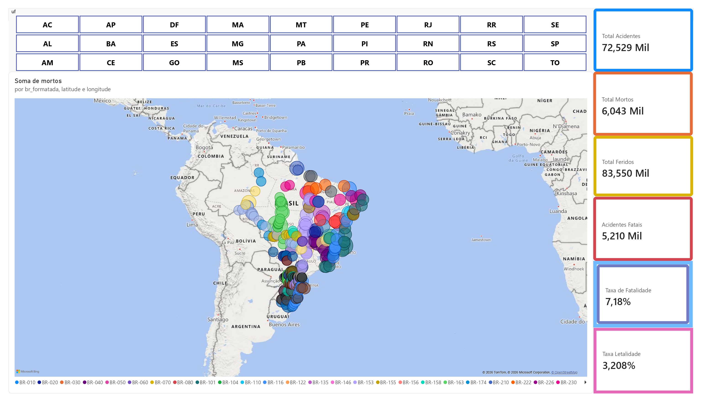

### 2. Geral 2 (Painel Executivo)
Visão consolidada com evolução mensal de acidentes vs. taxa de fatalidade, rankings por UF e distribuições proporcionais por dia da semana, fase do dia e condição meteorológica.

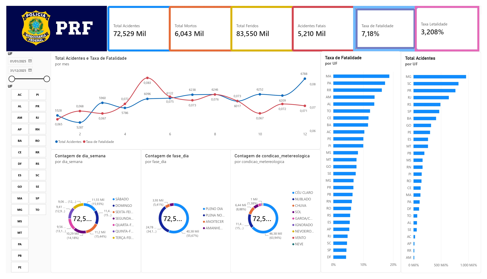

### 3. Acidentes Fatais
Análise cruzada entre tipos de acidente (colisão traseira, saída de leito carroçável, colisão frontal, atropelamento, etc.) e taxas de fatalidade, detalhada por tipo de pista (`Simples`, `Dupla`, `Múltipla`) e faixas horárias.

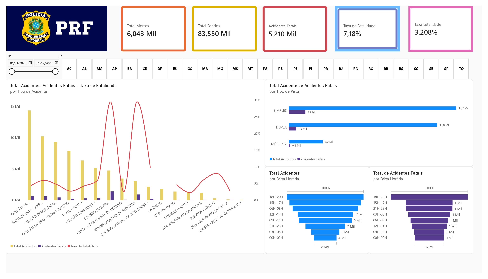

### 4. Análise Geográfica
Comparativo lado a lado entre a distribuição espacial do total de acidentes e do total de mortos por coordenadas geográficas, além de curva de concentração por `UF` e `BR`.

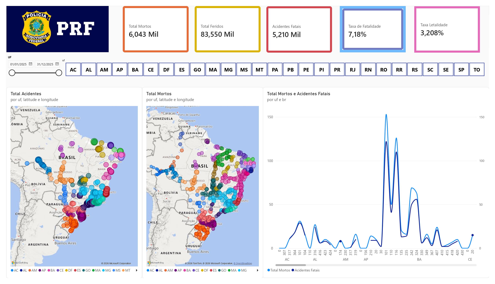

### 5. Análise Temporal
Sazonalidade mensal de acidentes, vítimas e mortes, complementada por gráficos de rosca que segmentam as ocorrências por trimestre, turno, dias úteis vs. finais de semana e faixas horárias.

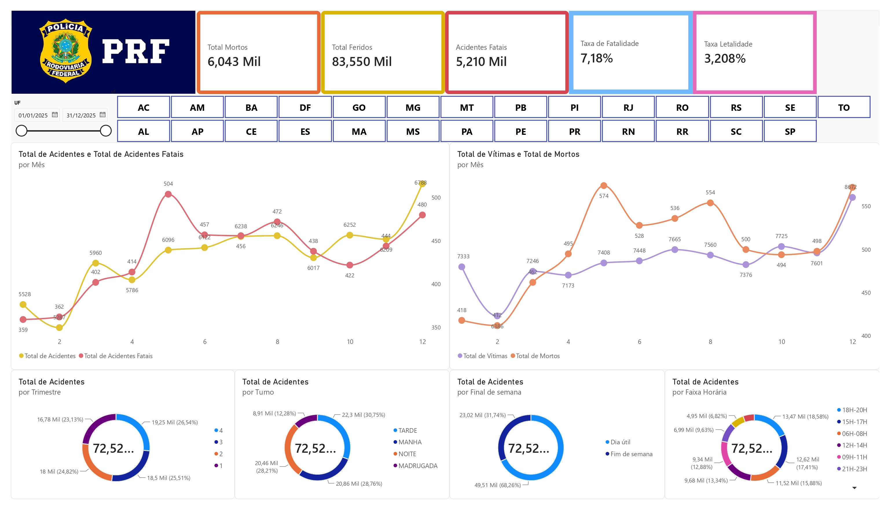

### 6. Fatores do Acidente
Diagnóstico das principais causas imediatas (ausência de reação do condutor, reação tardia, velocidade incompatível, ingestão de álcool, etc.), condições climáticas, tipos de pista e top rodovias (`BR`).

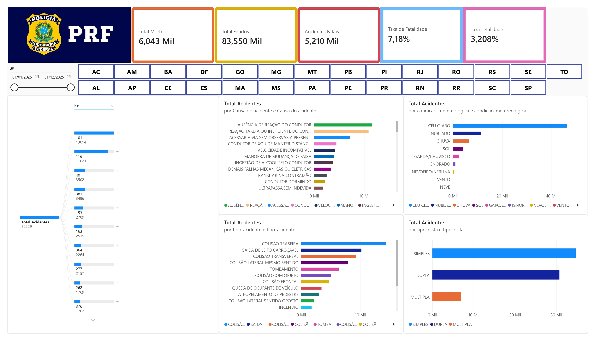

### 7. Acidentes Fatais PE
Mapa coroplético customizado (via arquivo **GeoJSON** dos municípios de Pernambuco) destacando a concentração regional de acidentes fatais no estado.

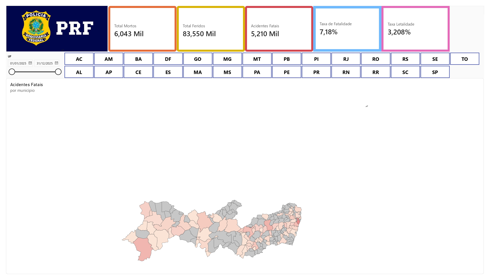

### 8. Fatores Acidente Fatal
Gráficos de dispersão correlacionando o volume de acidentes fatais (eixo X), a taxa de fatalidade (eixo Y) e o total de mortos (tamanho das bolhas) por UF, condição meteorológica e causa do acidente.

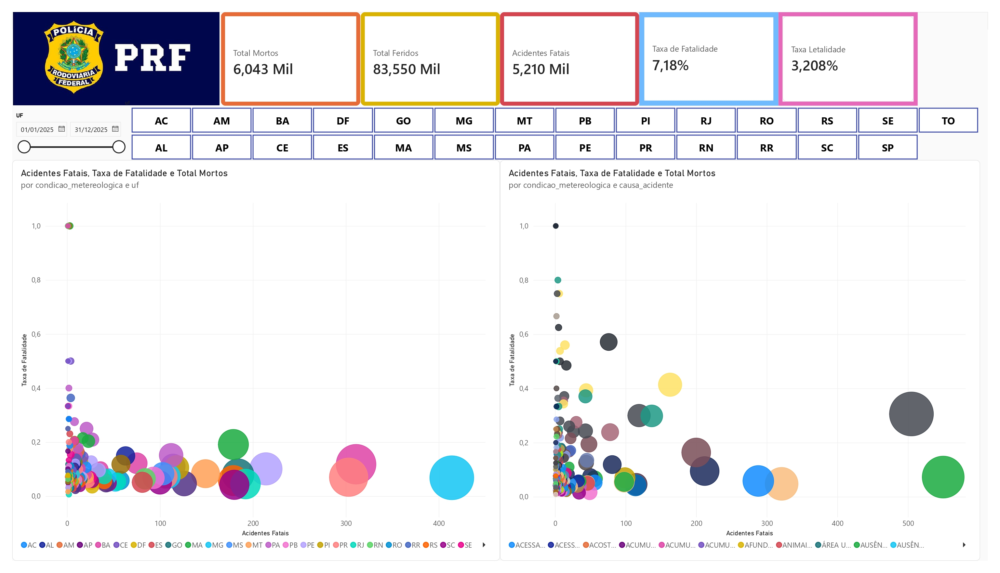

### 9. Treemap e Matriz de Calor
Hierarquia visual (`Treemap`) das rodovias federais com maiores taxas de fatalidade (destaque para `BR-210`, `BR-416`, `BR-308`, `BR-230`) combinada com matriz de calor por UF e tipo de pista.

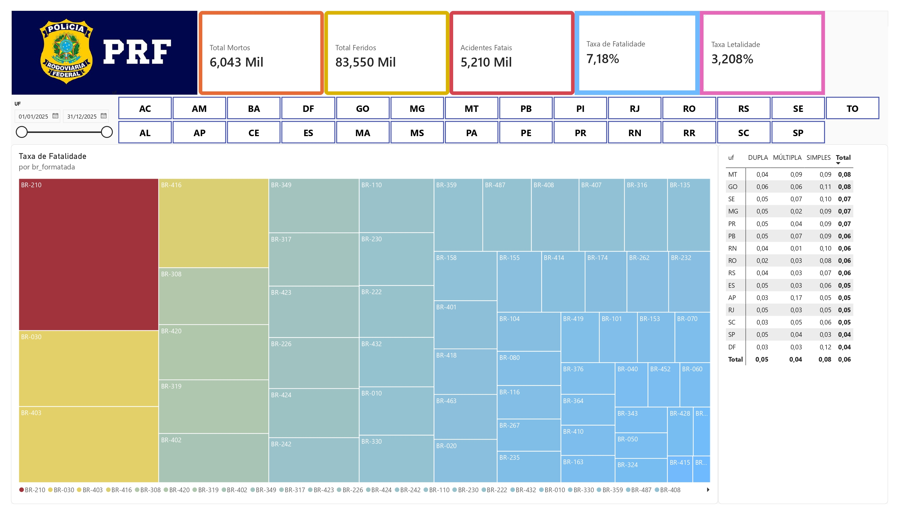

### 10. Matriz de Calor e Gráfico de Cascata
Cruzamento tabular entre dias da semana e faixas horárias (evidenciando picos nos domingos e sábados entre `18h e 20h`) aliado a um gráfico de cascata (`Waterfall`) detalhando a variação mensal por turno.

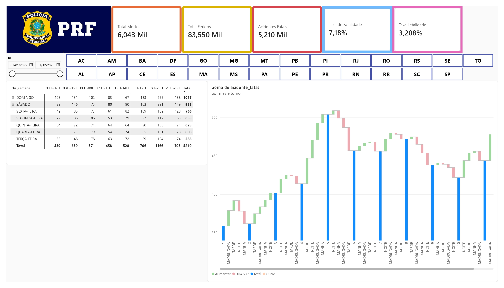

### 11. Pareto
Análise de Pareto (`80/20`) das causas de acidentes com curva de percentual acumulado, acompanhada da classificação de gravidade por ocorrência (`Com Vítimas Fatais`, `Com Vítimas Feridas` e `Sem Vítimas`).

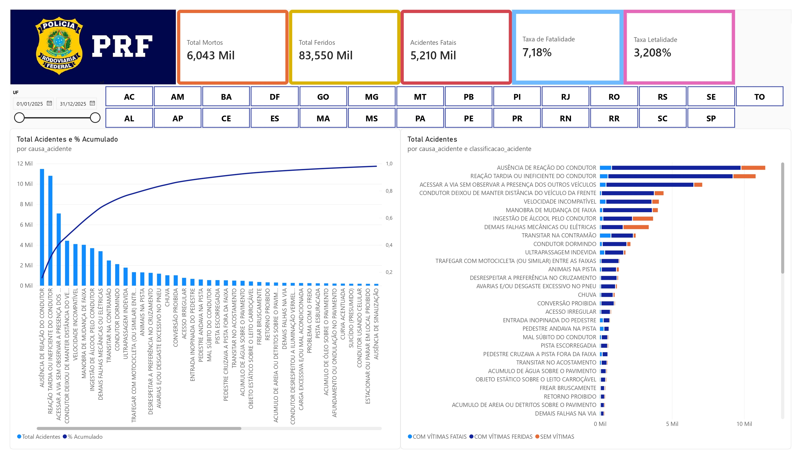

---

## 🛠️ Tecnologias, Modelagem e Recursos Utilizados

* **Power BI Desktop:** Construção do modelo analítico (`base_analitica_prf_2025`), visualizações nativas e personalizadas, segmentadores de período (`data_inversa`) e filtros dinâmicos por estado (`UF`).
* **Linguagem DAX:** Criação de medidas calculadas para indicadores de performance e análises estatísticas, incluindo:
  * Contagens e somatórios (`Total Acidentes`, `Total Mortos`, `Total Feridos`, `Acidentes Fatais`)
  * Taxas de severidade (`Taxa de Fatalidade`, `Taxa Letalidade`)
  * Análise acumulativa (`% Acumulado` para curva de Pareto)
  * Colunas/Medidas de categorização temporal (`FimDeSemana`, `faixa_horaria`, `fase_dia`)
* **Geoprocessamento (Shape Map / GeoJSON):** Integração de malha municipal estadual (`geojs-26-mun-padronizado.json`) para mapeamento coroplético de Pernambuco.
* **Identidade Visual & UX:** Paleta institucional alinhada à Polícia Rodoviária Federal (azul-marinho, amarelo-ouro e branco) com codificação semântica por cores nos cartões de KPIs para facilitar a leitura rápida.

---

## 📁 Estrutura do Repositório

```text
├── assets/                                     # Capturas de tela das 11 páginas do dashboard (.jpg)
├── data/
│   └── dicionario_base_analitica_prf_2025.md   # Documentação das colunas e medidas DAX do modelo
├── pbix/
│   └── dashboard-acidentes-prf-2025.pbix       # Arquivo fonte do projeto no Power BI
└── README.md                                   # Documentação principal do projeto
